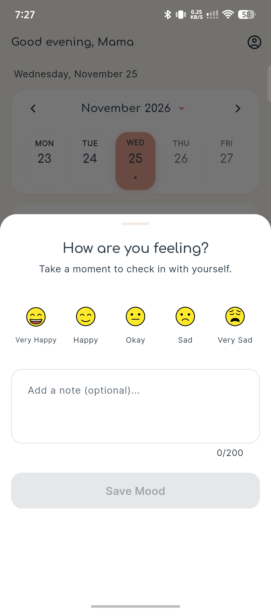
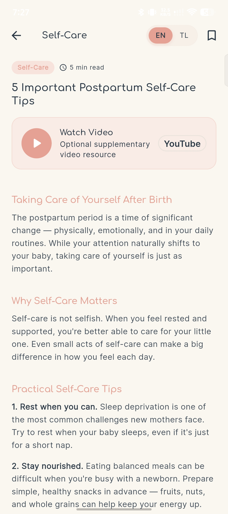
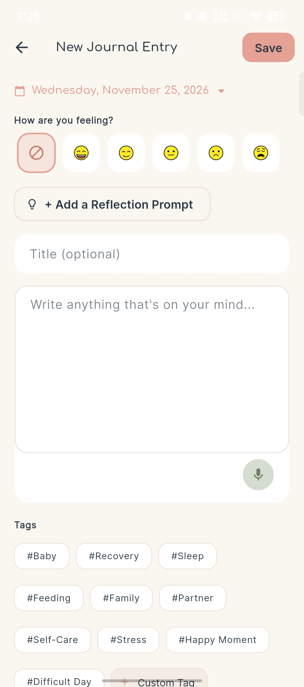

# MomEase

A cross-platform mobile application that supports mothers through the postpartum period with educational lessons and personal journaling.


## Overview

Postpartum depression affects many new mothers, yet accessible, structured support is often limited. MomEase was developed as a nursing research project to give postpartum mothers a private, easy-to-use space to learn about postpartum care and reflect on their experiences.

The app was built with Flutter to deliver a consistent experience across devices from a single codebase.

## Screenshots

| Mood Tracking | Educational Lessons | Journaling |
|:---:|:---:|:---:|
|  |  |  |

## Features

- **Educational Lessons:** Curated content on postpartum care, emotional wellbeing, and related topics, presented in short, readable lessons.
- **Personal Journaling:** A private space for mothers to record thoughts, experiences, and reflections over time.
- **Mood Tracking:** Mood logging to encourage emotional self-awareness. *(Include only if this is still in the current build.)*

## Tech Stack

| Category | Technology |
|---|---|
| Framework | Flutter |
| Language | Dart |
| Data Storage | Firebase |
| Tooling | Android Studio, Visual Studio Code, Git |

## Getting Started

### Prerequisites

- Flutter SDK (stable channel)
- Dart SDK (bundled with Flutter)
- Android Studio or Visual Studio Code with the Flutter extension
- An Android emulator or physical device

### Installation

1. Clone the repository:

   ```bash
   git clone https://github.com/eoghann-dev/mom-ease.git
   cd mom-ease
   ```

2. Install dependencies:

   ```bash
   flutter pub get
   ```

3. Run the application:

   ```bash
   flutter run
   ```

## Download

A pre-built Android APK is available for testing:

[Download MomEase APK](https://drive.google.com/file/d/1Vcha4Jx0bfwQKVlXUIzMI4c8i6Ega9Hd/view?usp=sharing)

## Disclaimer

MomEase is an educational and wellness tool. It is not a substitute for professional medical advice, diagnosis, or treatment. Mothers experiencing severe or persistent symptoms should consult a qualified healthcare provider.

## Author

**Owen Casabuena**
GitHub: [@eoghann-dev](https://github.com/eoghann-dev)
